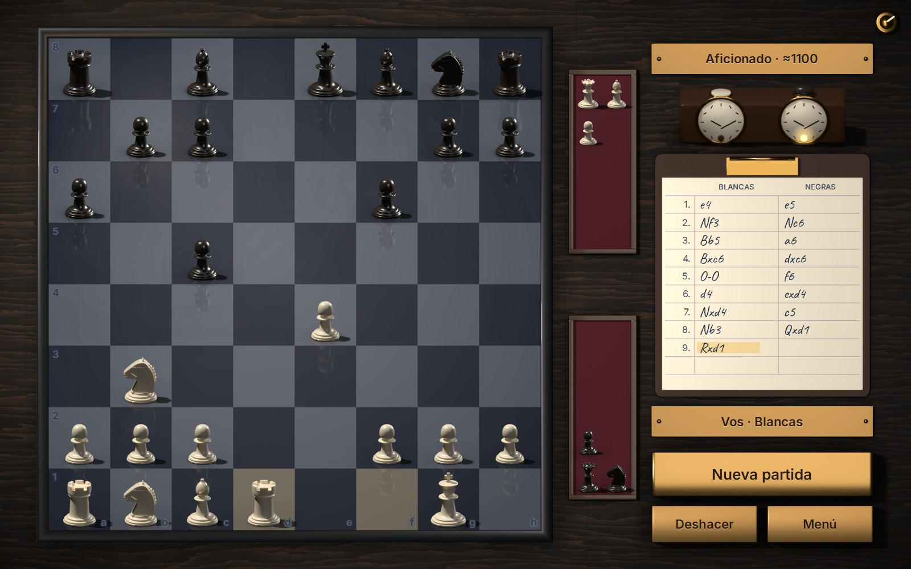
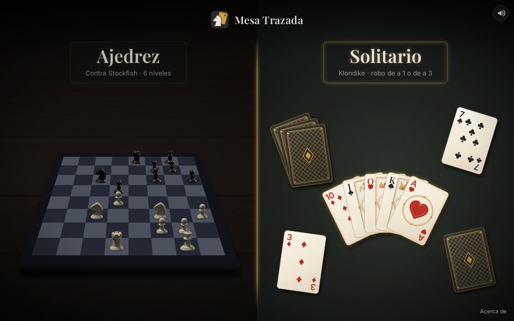
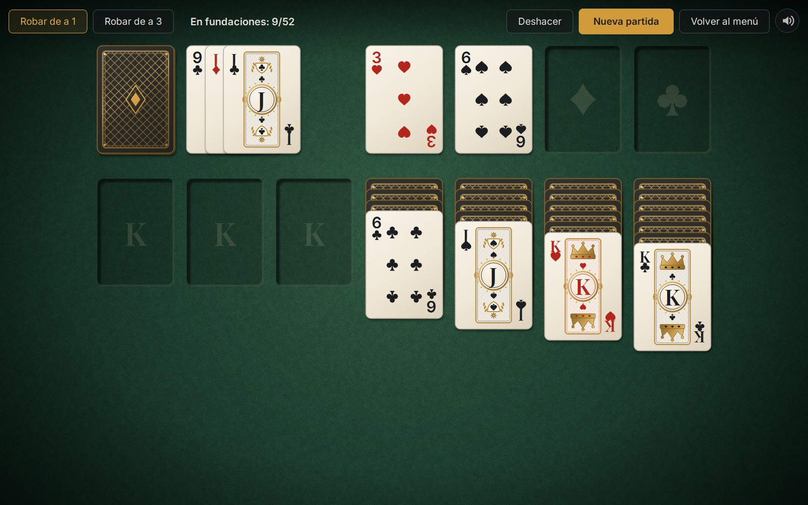
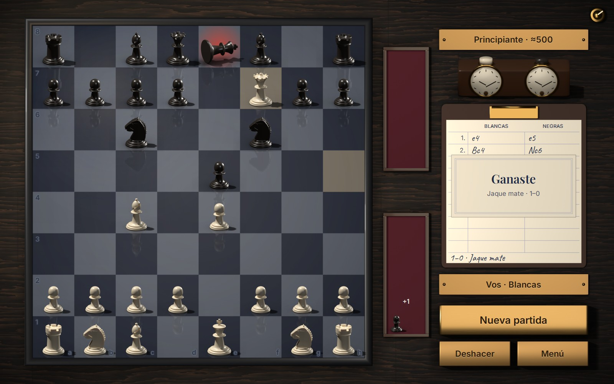
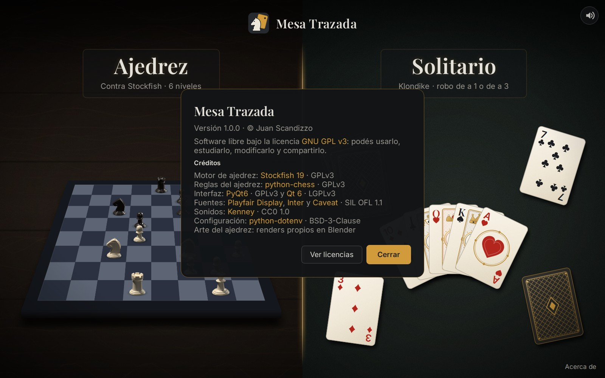

# Mesa Trazada

**Ajedrez contra Stockfish y Solitario Klondike para Windows. Gratis, sin publicidad y de código abierto.**



*[English below](#english)*

## Qué es
Una mesa de juego tranquila con dos clásicos:

- **Ajedrez contra Stockfish**, con 6 niveles calibrados, de *Principiante* (~500 Elo, para aprender) a *Máximo*
  (Stockfish sin límite). El tablero, las piezas y todo lo que hay sobre la mesa (la planilla con las jugadas escritas
  a mano, el reloj, las bandejas con las capturas, las placas de latón que hacen de botones) son renders propios
  hechos en Blender, con una única luz de lámpara. Deshacer, coronación, jaque mate con el rey que cae, y el resultado
  anotado en la planilla.
- **Solitario Klondike** en una mesa de casino: robo de a 1 o de a 3, deshacer ilimitado (Ctrl+Z), doble clic para
  subir a la fundación, animaciones cortas que nunca hacen esperar y un aviso honesto cuando ya no quedan movimientos
  (sólo avisa cuando lo pudo comprobar).
- Sonidos cortos y suaves, un único control de volumen, y todo funciona sin conexión a internet.

| | |
|---|---|
|  |  |
|  |  |

## Descargar y jugar
<!-- TODO: enlace a la página de itch.io cuando exista -->
1. Descargá `MesaTrazada-1.0.1-windows-x64.zip` (~130 MB) desde las
   [*Releases* del repositorio](https://github.com/AileriPnch/MesaTrazada/releases).
2. Descomprimilo en cualquier carpeta y abrí `MesaTrazada.exe`. No hay que instalar nada: el motor, las fuentes
   y los sonidos vienen incluidos.

Requisitos: Windows 10 u 11 de 64 bits. La interfaz está en español.

La app no está firmada digitalmente, así que la primera vez Windows SmartScreen puede decir *"Windows protegió su
PC"*: tocá **Más información → Ejecutar de todas formas**. Para desinstalar, borrá la carpeta.

## Niveles de dificultad
| Nivel | Elo aprox. | Cómo juega |
|---|---|---|
| Principiante | ~500 | Mira una jugada hacia adelante, elige entre varias candidatas y a veces se descuida |
| Novato | ~800 | Un poco más de profundidad y menos descuidos |
| Aficionado | ~1100 | Menos descuidos todavía |
| Club | 1400 | Stockfish con fuerza limitada (`UCI_Elo`) |
| Avanzado | 1800 | Stockfish con fuerza limitada (`UCI_Elo`) |
| Máximo | — | Stockfish sin límite |

Los tres primeros usan un debilitamiento propio (Stockfish no baja de 1320 Elo) y están calibrados haciendo jugar a
cada nivel contra el de abajo: cada uno le gana al anterior en al menos el 70 % de las partidas. El motor nunca
responde antes de 0,6 s, para que la partida tenga ritmo humano. Los valores se pueden ajustar con un archivo `.env`
(opcional; ver la [documentación técnica](docs/TECNICO.md#ajustar-la-dificultad-del-ajedrez)).

## Correr desde el código
Requiere Python 3.12 y Windows.
```powershell
git clone <url del repositorio>
cd MesaTrazada
py -3.12 -m venv .venv
.\.venv\Scripts\python.exe -m pip install -r requirements.txt
```
Descargá Stockfish 19 (`stockfish-windows-x86-64-universal.zip`) de
https://github.com/official-stockfish/Stockfish/releases/tag/sf_19 y guardá el ejecutable como
`engine\stockfish.exe` (con su `Copying.txt`). Después:
```powershell
.\.venv\Scripts\python.exe main.py          # la app
.\.venv\Scripts\python.exe -m pytest        # los tests
.\.venv\Scripts\python.exe scripts\build_windows.py   # el .zip para Windows
```
Todo lo demás (estructura, arte de Blender, calibración, build) está en [docs/TECNICO.md](docs/TECNICO.md).

## Créditos
- Motor de ajedrez: [Stockfish 19](https://github.com/official-stockfish/Stockfish) (GPLv3), incluido sin modificar.
- Reglas: [python-chess](https://github.com/niklasf/python-chess) (GPLv3) · Interfaz: [PyQt6](https://www.riverbankcomputing.com/software/pyqt/) (GPLv3) y [Qt 6](https://www.qt.io/) (LGPLv3).
- Fuentes: [Playfair Display](https://github.com/clauseggers/Playfair-Display), [Inter](https://github.com/rsms/inter) y [Caveat](https://github.com/googlefonts/caveat) (SIL OFL 1.1).
- Sonidos: [Kenney](https://kenney.nl) (CC0).
- Arte del ajedrez: renders propios en Blender. Cartas, figuras e inicio: dibujados por código.

Detalle de cada componente, versiones y enlaces al código fuente en [CREDITS.md](CREDITS.md).

## Licencia
© 2026 Juan Scandizzo. Software libre bajo la **GNU General Public License v3** ([LICENSE](LICENSE)): podés usarlo,
estudiarlo, modificarlo y compartirlo, siempre con esta misma licencia.

## Donaciones
El juego es y va a seguir siendo gratis. Si te gusta y querés invitarme un café:
[Cafecito](https://cafecito.app/aileri) (desde Argentina) o [Ko-fi](https://ko-fi.com/aileri57918).

---

## English
**Chess against Stockfish and Klondike Solitaire for Windows. Free, no ads, open source (GPLv3).**

- **Chess** against Stockfish with 6 calibrated levels, from *Principiante* (beginner, ~500 Elo) to *Máximo*
  (full-strength Stockfish). The board, pieces and everything on the table (a hand-written scoresheet, a chess clock,
  captured-piece trays, brass plates as buttons) are original Blender renders under a single lamp.
- **Klondike Solitaire** on a casino table: draw 1 or 3, unlimited undo, double-click to the foundations, short
  animations that never make you wait, and an honest "no moves left" notice.
- Works offline. The interface is in Spanish.

**Download:** get `MesaTrazada-1.0.1-windows-x64.zip` from the repository
[*Releases*](https://github.com/AileriPnch/MesaTrazada/releases) <!-- TODO: itch.io page -->, unzip
it anywhere and run `MesaTrazada.exe` (Windows 10/11, 64-bit; nothing to install). The app is not code-signed:
if SmartScreen warns you, choose *More info → Run anyway*.

**From source:** Python 3.12, `pip install -r requirements.txt`, put Stockfish 19 at `engine\stockfish.exe` and run
`python main.py`. Credits and third-party licenses: [CREDITS.md](CREDITS.md). License: [GPLv3](LICENSE).

**Donations:** the game is and will stay free. If you enjoy it, you can buy me a coffee on
[Ko-fi](https://ko-fi.com/aileri57918) or [Cafecito](https://cafecito.app/aileri).
